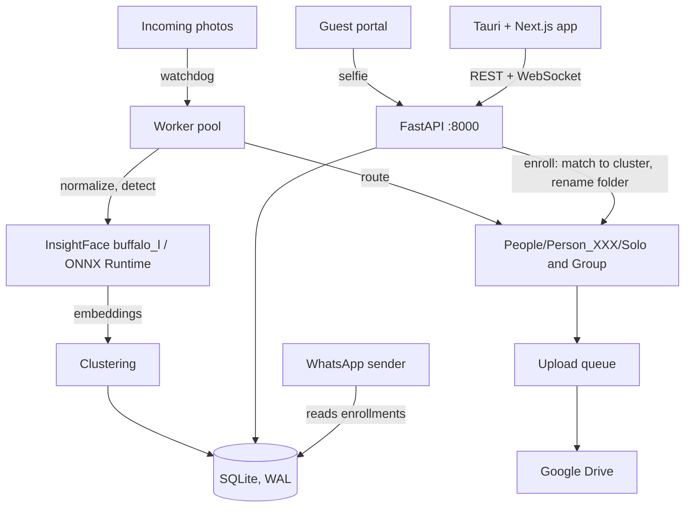

# System Architecture: AURA (by DARK intelligence)

Updated 2026-11-14. **Note:** this describes the planned v3.0.0 (Tauri + Next.js) layout. That work is unfinished and was moved to `_archive_tauri_v3/`; the active app is the v2.0.0 PySide6 desktop app (`aura_app/` launched by `run_pyside.py`), which starts the same backend processes (server, worker, WhatsApp) itself. The backend, pipeline and guest portal below are the same in both.

## Layers

1. **Desktop app (Tauri 2 + Next.js)**: the admin dashboard (stats, people, processing, cloud, WhatsApp, health, settings). Tauri starts the backend sidecar and the UI talks to it at `localhost:8000` (REST and WebSocket).
2. **Python backend sidecar (`aura-backend`)**: one executable started with three flags by Tauri:
   - `--run-server`: FastAPI guest server (`frontend/server.py`; guest-only since 2026-11-14, no admin API).
   - `--run-worker`: watcher, worker pool, clustering, routing, upload queue.
   - `--run-whatsapp`: WhatsApp sender.
3. **Guest portal**: static page served by the same FastAPI server. Guests enroll with a selfie and see their photos.

## Photo pipeline

1. A file appears in `EventRoot/Incoming/`; the watcher registers it (file hash prevents duplicates).
2. A worker normalizes it (RAW/HEIC/etc. to JPEG, resize to 2048, EXIF orientation), makes a thumbnail, and detects faces.
3. Each face embedding is assigned to the nearest person centroid by cosine distance, or becomes a new person.
4. The router places the photo in the person's Solo or Group folder.
5. The upload queue syncs to Google Drive (a phase coordinator alternates processing and uploading).
6. A guest enrolls with a selfie; it is matched to a person, the folder is renamed, and WhatsApp sends their link.

## Technologies

- AI: `insightface` (buffalo_l), `onnxruntime-directml` (graphics card via DirectML or CPU, chosen by a one-time speed test; see `backend/app/compute.py`).
- Backend: Python, FastAPI, `watchdog`, `sqlite3` (WAL), Google Drive API.
- Desktop: Tauri 2 (Rust), Next.js 16, React 19, Tailwind 4, Zustand, TanStack Query, Recharts.
- Packaging: PyInstaller (sidecar) and Tauri NSIS installer.

## Known gaps

Fixed 2026-11-14: the web server is guest-only (no admin API; per-guest gallery keys) and clustering is atomic. Remaining open items are tracked in `todo/future_improvements.md`.
